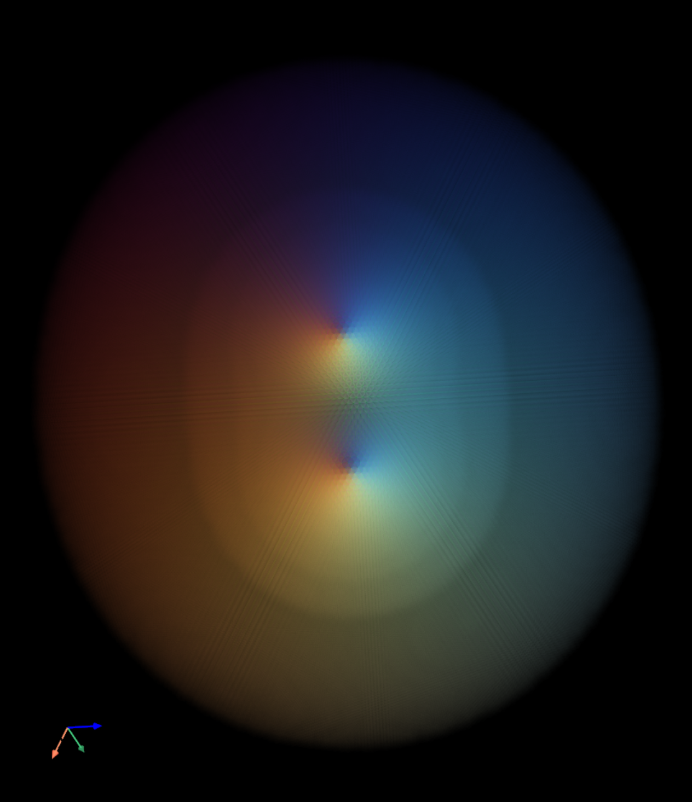
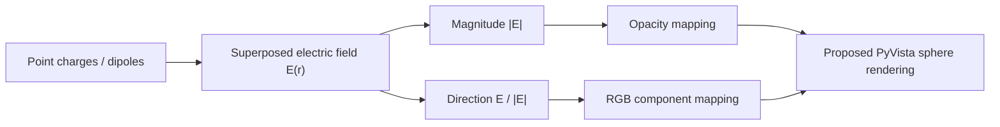
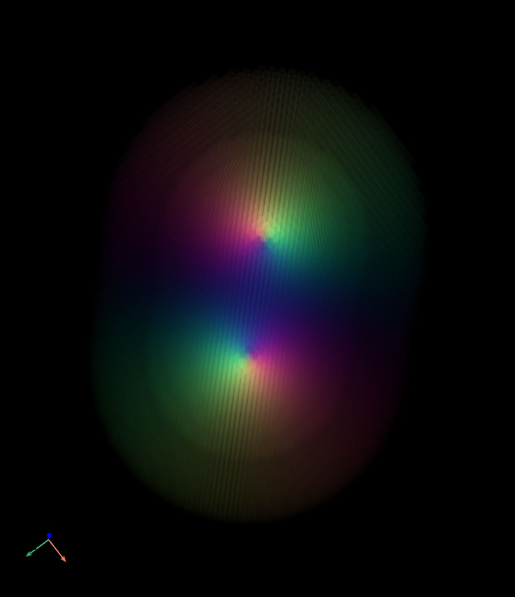
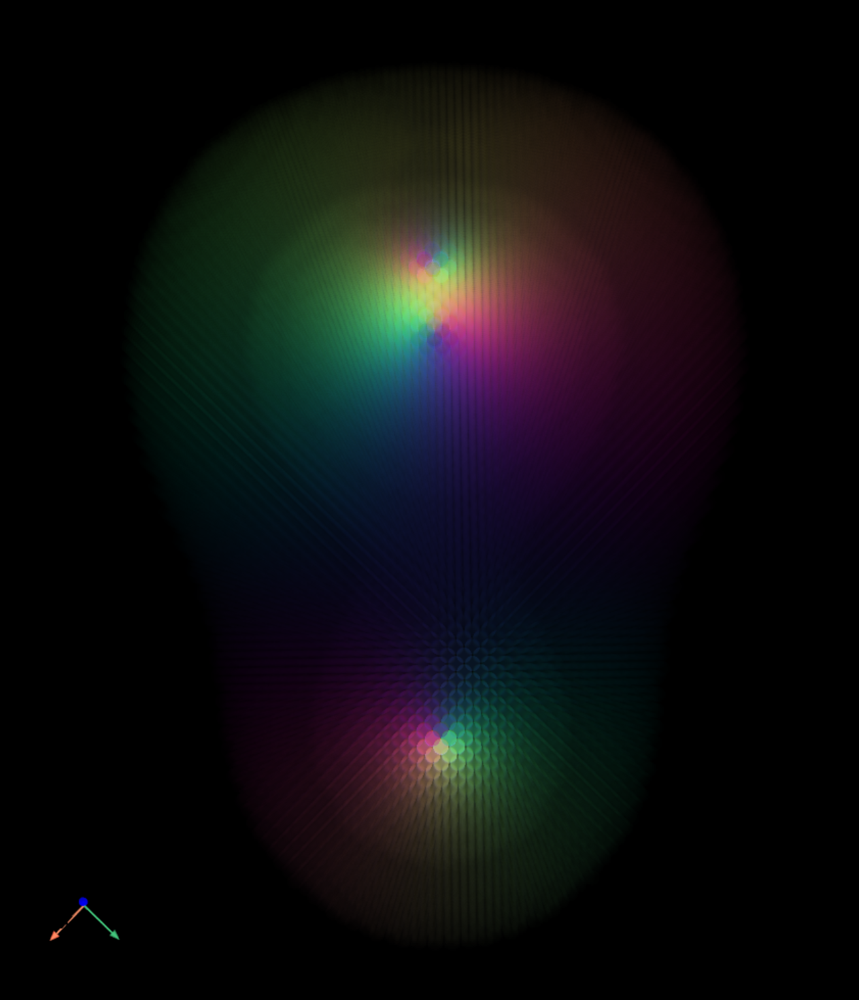
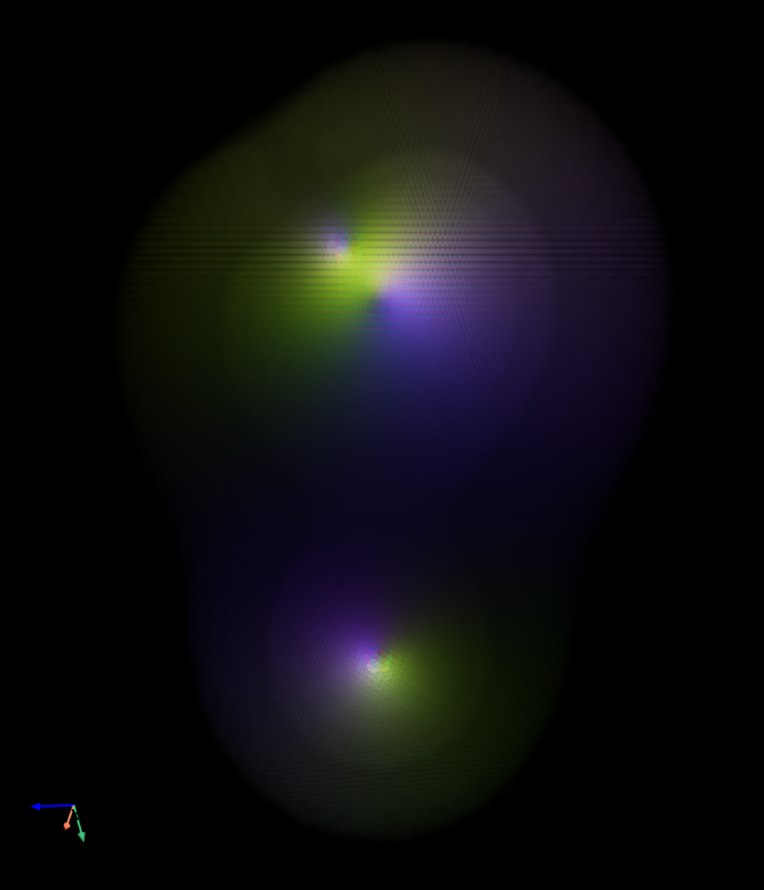

# EM-Visulization

**A visual concept for seeing electric-field direction as color and field strength as transparency.**

[中文](README.zh-CN.md) · [Original-image gallery](docs/showcase/gallery.html) · [Asset provenance](docs/showcase/manifest.json) · [License](LICENSE)



Original project image, labeled **two positive charges** in the earlier README. Preserved from its public GitHub attachment without alteration. The image is a visual example; source parameters and a quantitative color legend were not published with it.

## What this repository contains

This is a **concept and image showcase**. The public source snapshot contains a README and MIT license; it does not contain the described field-calculation or PyVista rendering implementation. There is currently no install command, runnable simulation, dependency lockfile or verified application release.

The images below were already public in this repository. They are not newly generated results and do not establish reproducibility of the proposed renderer.

## The proposed representation

The original description outlines the following pipeline:

1. Superpose point-charge and dipole electric fields at sampled positions.
2. Compute the magnitude of the resulting vector and map normalized magnitude to opacity.
3. Normalize the field direction and associate its X, Y and Z components with red, green and blue.
4. Represent samples as glowing spheres in a 3D grid using PyVista.
5. Allow rotation, zoom and pan in the proposed interactive view.



This diagram restates the documented concept. It does not describe an available executable pipeline.

**Reading limits:** the exact signed-component-to-RGB transform, opacity transfer function, normalization scale, sample spacing, charge strengths, source positions, camera and singularity handling are not specified. In particular, negative vector components need an explicit color mapping and E = 0 has no defined direction. The published images therefore support qualitative inspection, not numeric field reconstruction.

## Original image examples

<table>
<tr><td></td><td></td></tr>
<tr><td>Electric dipole — original README label.</td><td>Complex case — source configuration unspecified.</td></tr>
</table>



Each file is linked to its original attachment and SHA-256 digest in the [manifest](docs/showcase/manifest.json). The [offline gallery](docs/showcase/gallery.html) presents all four preserved examples and their source links.

## View locally

No simulation runtime is published. To browse only the saved documentation and images, open `docs/showcase/gallery.html` directly, or serve this folder with an existing Python installation:

```bash
python -m http.server 8000 --bind 127.0.0.1
# Open http://127.0.0.1:8000/docs/showcase/gallery.html
```

Stop the documentation server with Ctrl+C. Python is used only for optional static serving; this is not a field solver or the proposed PyVista application.

## Implementation status

| Item | Public status |
| --- | --- |
| Concept and sample images | Available |
| Field-calculation source | Not published in snapshot `30753de3e55b9920323891689174e0e35e34821f` |
| Renderer / interactive viewer | Described, implementation not published |
| Dependency versions / startup command | Not specified for an application |
| Quantitative validation / benchmarks | Not provided |

A reproducible release would need the field equations and parameters, signed RGB and opacity definitions, treatment of zero-field points and source singularities, and a pinned runnable renderer. These are documentation gaps, not claims that this pass implemented them.

## License

The repository's existing [MIT License](LICENSE), copyright 2025 Wang Keren, is preserved. Image provenance is recorded separately in the manifest.
