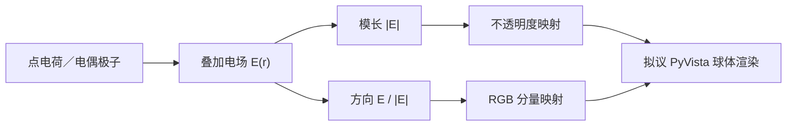

# EM-Visulization

**以颜色表达电场方向、以透明度表达场强的可视化构想。**

[English](README.md) · [原始图片图集](docs/showcase/gallery.html) · [资产来源](docs/showcase/manifest.json) · [许可](LICENSE)


这是原项目已公开、标为 **two positive charges（两个正电荷）** 的图片，从 GitHub 附件原样保存。它是视觉示例，原发布没有附带源参数和定量颜色图例。

## 仓库实际包含什么

目前这是**概念与图片展示仓库**。公开源码快照仅包含 README 与 MIT 许可，没有所描述的场计算或 PyVista 渲染实现，也没有可运行仿真、依赖锁定文件、安装命令或经过验证的应用发行版。

以下图片在本仓库此前已公开，不是本轮新计算结果，也不能作为所提渲染器可复现的证据。

## 可视化构想

原描述给出以下流程：

1. 在采样位置叠加点电荷与电偶极子的电场。
2. 计算合场的向量模长，将归一化模长映射为不透明度。
3. 归一化电场方向，将 X、Y、Z 分量关联到红、绿、蓝三个通道。
4. 使用 PyVista，在三维网格上将采样点表示为发光球。
5. 在拟议交互视图中支持旋转、缩放和平移。



该图重述公开构想，不表示已有可执行流程。

**读图范围：**有符号分量到 RGB 的精确映射、不透明度传递函数、归一化尺度、采样间距、电荷强度、源位置、相机以及奇点处理均未公开。负分量需要明确的颜色规则，E = 0 处也没有确定方向。因此现有图适合定性查看，不能用于反演数值电场。

## 原始示例

<table>
<tr><td></td><td></td></tr>
<tr><td>电偶极子——沿用原 README 标签。</td><td>复杂情形——源配置未公开。</td></tr>
</table>


[manifest](docs/showcase/manifest.json)记录每个文件的原始附件链接和 SHA-256。[离线图集](docs/showcase/gallery.html)包含四张保存的原图与来源。

## 本地查看

尚未公开仿真运行程序。可以直接打开 `docs/showcase/gallery.html` 查看已保存文档和图片，或使用已有 Python 环境提供静态服务：

```bash
python -m http.server 8000 --bind 127.0.0.1
# 打开 http://127.0.0.1:8000/docs/showcase/gallery.html
```

Ctrl+C 停止服务。这里 Python 仅用于可选的静态文档服务，不是场求解器或拟议的 PyVista 应用。

## 实现状态

| 项目 | 公开状态 |
| --- | --- |
| 构想与示例图片 | 已提供 |
| 场计算源码 | 快照 `30753de3e55b9920323891689174e0e35e34821f` 中未发布 |
| 渲染器／交互查看器 | 有描述，未公开实现 |
| 应用依赖版本／启动命令 | 未提供 |
| 定量验证／性能基准 | 未提供 |

可复现发行版需要补齐方程与参数、带符号 RGB 和透明度定义、零场点及源奇点处理，以及固定依赖的可运行渲染器。这些是现有资料的缺口，本轮没有声称实现它们。

## 许可

保留仓库已有的 [MIT 许可](LICENSE)，版权为 2025 Wang Keren。图片来源另在 manifest 中记录。
